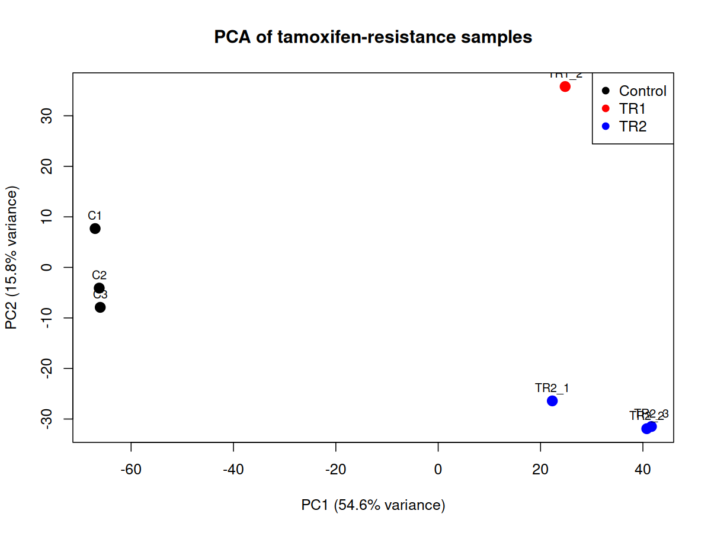
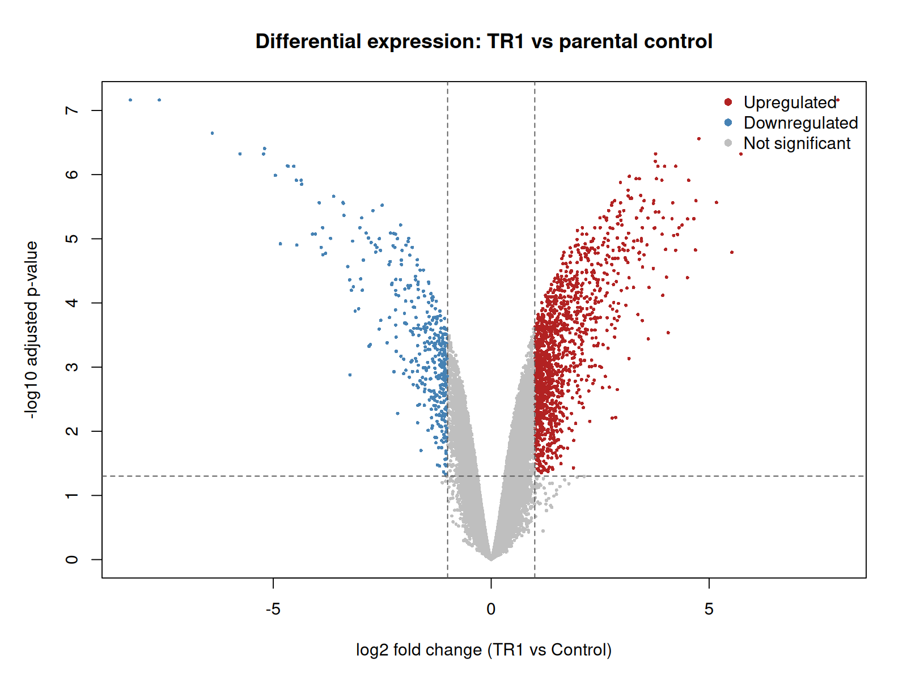
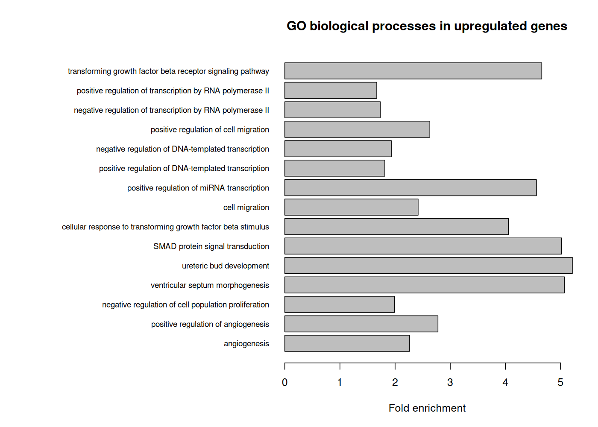
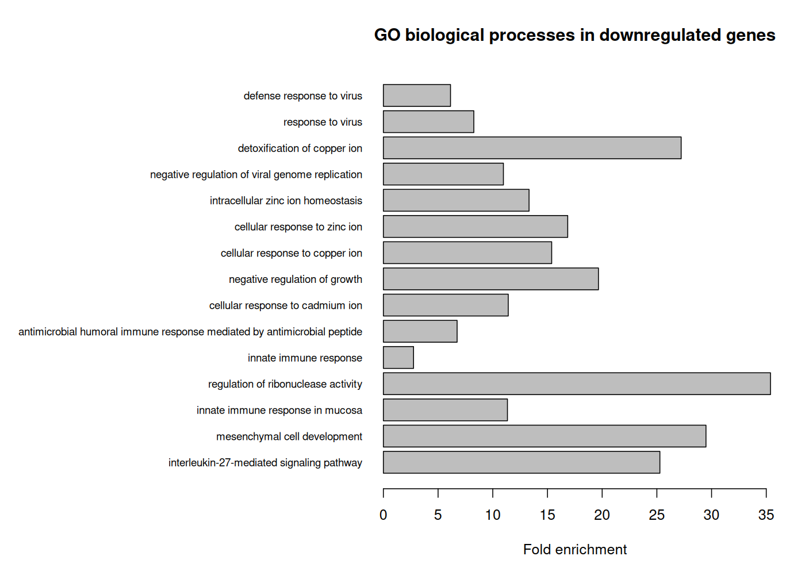

# Transcriptomic Analysis of Tamoxifen Resistance in MCF-7 Breast Cancer Cells

## Project Overview

This independent bioinformatics project investigates gene-expression differences between parental MCF-7 breast cancer cells and tamoxifen-resistant derivatives using publicly available microarray data.

**Research question:** Which genes and biological processes differ between tamoxifen-resistant TR1 cells and parental MCF-7 controls?

## Dataset

- **GEO accession:** [GSE241654](https://www.ncbi.nlm.nih.gov/geo/query/acc.cgi?acc=GSE241654)
- **Platform:** Affymetrix Human Genome U133 Plus 2.0 Array (GPL570)
- **Total samples:** 9
- **Groups:** 3 parental controls, 3 TR1-resistant samples and 3 TR2-resistant samples

The primary differential-expression analysis compares TR1-resistant cells with parental controls. TR2 samples are included in exploratory sample-level analysis.

## Methods

1. **Normalisation:** Raw Affymetrix CEL files were processed using Robust Multi-array Average (RMA).
2. **Exploratory analysis:** Principal component analysis (PCA), expression-distribution plots and heatmaps were used to explore sample-level patterns.
3. **Differential expression:** The `limma` package was used to compare TR1-resistant cells with parental controls.
4. **Probe annotation:** Probe identifiers were mapped to gene symbols and gene names.
5. **Functional enrichment:** Gene Ontology (GO) biological-process enrichment was investigated using hypergeometric tests and Benjamini–Hochberg multiple-testing correction.
6. **Candidate-gene exploration:** TGF-β/SMAD-associated genes and interferon/antiviral-associated genes were examined.

## Key Findings

### 1. Sample-level expression patterns

PCA showed separation between parental controls and resistant samples, with additional differences between TR1 and TR2. These patterns suggest differences in transcriptomic profiles but do not establish their biological cause.

### 2. Differential expression

The TR1-versus-control analysis identified numerous differentially expressed probes. The volcano plot shows estimated fold changes and statistical significance.

### 3. Upregulated genes: TGF-β/SMAD-associated processes

GO enrichment highlighted TGF-β receptor signalling and related transcriptional-regulation processes among upregulated genes. Candidate genes included **TGFB2, TGFBR2, SMAD3, SMAD6** and **SMAD7**.

These findings suggest that TGF-β/SMAD-associated processes warrant further investigation. Enrichment alone does not prove pathway activation or causality.

### 4. Downregulated genes: interferon/antiviral-associated processes

Downregulated genes were enriched for GO terms related to antiviral and interferon-associated responses. Examples included **IFIT1, ISG15, IFI6, IFIT3** and **OAS1**.

These results indicate differences in expression of genes annotated to these processes; they do not establish altered immune function or explain how resistance developed.

## Repository Structure

- `data/` — raw CEL archive and normalised expression object
- `scripts/` — R scripts for data processing and differential-expression analysis
- `results/` — differential-expression tables, enrichment results and candidate-gene tables
- `figures/` — PCA, volcano plot, heatmaps, expression-distribution and GO enrichment figures

## Limitations

- Each group contains three biological replicates, limiting statistical power and generalisability.
- The primary comparison focuses on TR1-resistant cells versus parental controls.
- Multiple microarray probes may map to the same gene, and probe annotation can be ambiguous.
- Enrichment results depend on gene selection, the background universe and annotation databases.
- Enrichment identifies statistical associations, not pathway activation or causality.
- Independent validation would be required to confirm candidate genes and investigate their functional roles.

## Future Directions

- Compare TR2-resistant cells with parental controls to assess whether findings are shared between resistant derivatives.
- Improve probe-to-gene summarisation and document gene-selection thresholds.
- Explore additional biological processes and candidate genes.
- Validate selected findings using an independent dataset or experimental follow-up.

## Tools and Packages

- R
- GEOquery
- affy
- limma
- AnnotationDbi
- hgu133plus2.db
- GO.db
- org.Hs.eg.db
- pheatmap

## Data Source

Expression data were obtained from the NCBI Gene Expression Omnibus (GEO), accession [GSE241654](https://www.ncbi.nlm.nih.gov/geo/query/acc.cgi?acc=GSE241654).

This is an independent exploratory analysis of publicly available data.
